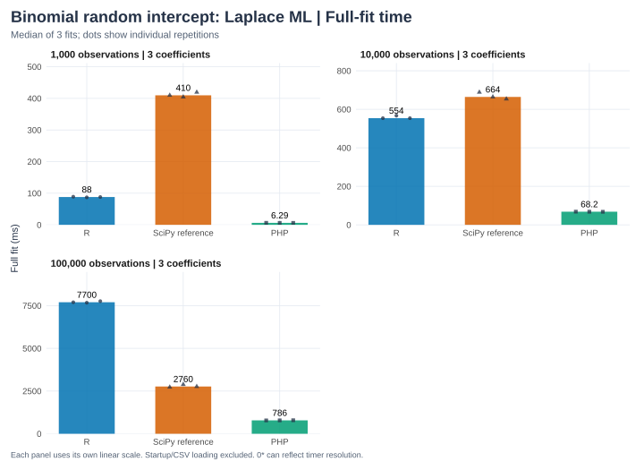

This benchmark fits the same **Laplace marginal ML** model in R lme4, an independent
Python/SciPy reference implementation, and the native PHP extension. It uses
shared deterministic binary data, correlated study/practice predictors, three fixed
coefficients and 50 groups at 1,000, 10,000 and 100,000 observations.

The Python worker is our likelihood/optimizer reference, **not** statsmodels'
Bayesian mixed-model estimator and not an optimized Python GLMM package. These
measurements compare the named implementations; they do not establish a general
Rust-versus-Python speed ranking.

## Timing boundaries and correctness

Each worker loads the same CSV, performs one warm-up fit, then runs three timed
fits. PHP times the complete native call, including conversion and all returned
inference/observation arrays. R/Python materialize covariance, standard errors,
conditional modes and full fixed/conditional fitted values and residuals. Compact
sample output and JSON serialization happen outside the timed fit. Process time
includes startup, CSV load, warm-up and all timed fits; peak RSS covers the whole
worker process. Threads are pinned to one.

Every report is published only after coefficients, covariance/standard errors,
group SD/modes, normalized likelihood and common observation samples agree.
Likelihood tolerance is absolute 1e-6 plus relative 1e-8; inference uses absolute
2e-5 plus relative 2e-3; estimates use absolute 2e-5 plus relative 2e-4. Group modes
use absolute 5e-5 because large-sample flat-profile optimization produced shifts
around 2e-5 in modes near zero; relative error there is not informative.

The installed lme4 version disables derivative checks automatically at large n.
The benchmark explicitly enables the final joint Hessian. Its initial BOBYQA run
also stopped short on the 10,000-row case; an R-only restart from that fit,
with rhobeg=0.001 and nAGQ0initStep=FALSE, resolved it. **Both R stages are included
in its fit time.** The report records these controls, versions and data/binary
hashes. Native estimates never seed the R worker.

## Results

```{python}
from pathlib import Path
import json
import pandas as pd

from IPython.display import display
ROOT=next(p for p in [Path.cwd(),*Path.cwd().parents] if (p/'Cargo.toml').exists())
report=json.loads((ROOT/'docs/benchmarks/logistic-mixed-results.json').read_text())
ORDER=['R','SciPy reference','PHP']
rows=[]
for case in report['cases']:
    for label in ORDER:
        r=case['implementations'][label]
        rows.append(dict(observations=case['n'],groups=case['n_groups'],implementation=label,
                         median_fit_seconds=r['median_fit_seconds'],CSV_load_seconds=r['load_seconds'],
                         whole_process_seconds=r['process_seconds'],
                         peak_process_RSS_MiB=r['peak_rss_bytes']/2**20 if r['peak_rss_bytes'] else None,
                         numerical_agreement=case['agreement_passed']))
table=pd.DataFrame(rows);display(table)
print('Machine:',report.get('cpu'),report['platform'])
print('Threads:',report['thread_environment'])
print('Versions:',{name:report['cases'][0]['implementations'][name]['version'] for name in ORDER})
import subprocess,os
subprocess.run([os.environ.get('RSCRIPT','Rscript'),str(ROOT/'docs/figures/render.R'),'logistic-mixed'],check=True)
```




These are 50-group, three-coefficient, one-intercept models using the one-node
approximation. They do not benchmark 61-node integration, random slopes or multiple
grouping terms. A larger dataset does not by itself establish approximation accuracy;
see the [independent integration checks](../notebooks/logistic-mixed-verification.qmd).
The full measurements and errors are in the [saved report](logistic-mixed-results.json).

## Reproduce

```sh
cargo build -p php-stats --release --locked
PHP=/opt/homebrew/bin/php .context/notebooks-venv/bin/python \
  tests/benchmarks/run-logistic-mixed.py --sizes 1000,10000,100000 --repeats 3
```

Use a matching PHP/php-config installation and `.so` on Linux. This is a developer
command; unit tests do not execute performance benchmarks.
