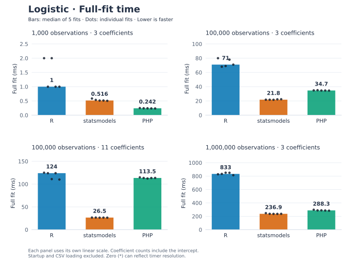
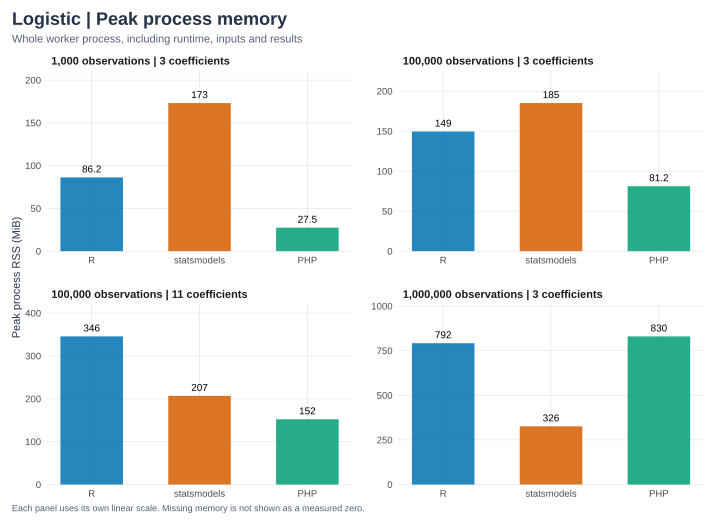

The standard benchmark compares the release PHP extension, R `glm(binomial)`
and statsmodels `Logit` on identical synthetic observations. The
[raw report](logistic-results.json) preserves all timing samples, machine and
runtime versions, input hashes, numerical outputs and differences from R.

## Recorded results

```{python}
from pathlib import Path
import json
import pandas as pd

# Keep display order independent of the benchmark worker execution order.
def ordered_table(rows):
    table = pd.DataFrame(rows)
    table["implementation"] = pd.Categorical(
        table["implementation"], categories=["R", "statsmodels", "PHP"], ordered=True)
    return table.sort_values(["observations", "coefficients", "implementation"]).reset_index(drop=True)

ROOT = next(p for p in [Path.cwd(), *Path.cwd().parents] if (p / "Cargo.toml").exists())
report = json.loads((ROOT / "docs/benchmarks/logistic-results.json").read_text())
assert report["model"] == "logistic"
print("Recorded:", report["recorded_at"])
print("Machine:", report["cpu"], report["platform"])
print("Rust:", report["rust"])
print("Repeats:", report["repeats"], "Warm-ups:", report["warmups"])
rows, memory = [], []
for case in report["cases"]:
    assert case["agreement_passed"]
    for name, fit in case["implementations"].items():
        rows.append({"observations": case["n"], "coefficients": case["p"],
                     "implementation": name, "version": fit["version"],
                     "median full fit (ms)": 1000*fit["median_fit_seconds"],
                     "minimum full fit (ms)": 1000*fit["min_fit_seconds"]})
        memory.append({"observations": case["n"], "coefficients": case["p"],
                       "implementation": name, "CSV load (s)": fit["load_seconds"],
                       "whole process (s)": fit["process_seconds"],
                       "peak process RSS (MiB)": fit["peak_rss_bytes"]/2**20 if fit["peak_rss_bytes"] else None})
display(ordered_table(rows))
```

The cases include 1,000, 100,000 and one million observations with three
coefficients, and 100,000 observations with eleven coefficients. Counts include
the intercept. On this recorded Mac, the million-observation median was about
405 ms for PHP, 240 ms for statsmodels and 804 ms for R. The wider case took about
79 ms, 27 ms and 121 ms respectively. These observations describe this workload
and environment, not a universal ranking.

## Visual comparison

```{python}
#| echo: false
import sys
sys.path.insert(0, str(ROOT / "docs/benchmarks"))
from plots import render_charts
render_charts(report, "logistic")
```





R, statsmodels and PHP use the same order and colors throughout. Each panel has
its own linear scale so small workloads remain readable; compare labeled values
across panels. Memory covers the entire worker process. It is not the solver's
allocation count. All workloads passed the numerical checks described below.

Download the timing [SVG](figures/logistic-fit-time.svg) or [PNG](figures/logistic-fit-time.png),
and memory [SVG](figures/logistic-memory.svg) or [PNG](figures/logistic-memory.png).
Charts refresh from saved measurements when this page is executed; they do not
rerun the benchmarks.

## What is timed?

Workers load the same CSV once, perform one untimed warm-up, and measure five
full fits. Each timed fit materializes coefficients, covariance, standard errors,
normal z tests, p-values, Wald intervals, every fitted probability and response
residual, likelihood, deviance, null deviance, AIC and residual degrees of freedom.
PHP also converts inputs and all outputs and constructs row metadata within the
timer. Startup, CSV loading, data generation and final JSON serialization are excluded.

R uses formula/model construction and QR-based IRLS, with epsilon 1e-14 to stabilize
covariance agreement. Python uses Newton fitting with tolerance 1e-10; PHP uses
weighted SVD Newton updates and its documented convergence rules. Starting values,
linear solves and stopping criteria differ. This is a comparison of complete
public API calls, not equal iteration counts or isolated decomposition speeds.
Common numerical-library thread variables are set to one; installed backends
and requested settings are recorded. Workers run separately with order alternated
between cases. Other machine activity can affect measurements. R's elapsed timer
has coarse millisecond resolution for small cases.

```{python}
display(ordered_table(memory))
```

Whole-process time includes loading, imports, warm-up and every measured fit.
Peak resident memory covers the entire worker, not just the numerical solver.
PHP memory_limit is disabled for this experiment because large nested PHP arrays
can exceed typical application limits. See the [OLS benchmark](ols.qmd) for the
shared harness and further interpretation of these boundaries.

## Simulation and agreement

NumPy RNG seed 20261011 generates study hours uniformly between 1 and 12, practice
scores as clipped 45 + 3 × hours + normal noise with standard deviation 8, and
independent standard-normal preparation scores for the wider case. Binary outcomes
are independent Bernoulli draws with

$$\eta_i=-3.28+0.22\,\mathrm{hours}_i+0.018\,\mathrm{score}_i
+0.15\sum_j\mathrm{preparation}_{ij},\qquad
\pi_i=\frac{1}{1+e^{-\eta_i}}.$$

This simulation is separate from the small R-generated teaching sample; its
values are unrounded and its seed is different. Every runtime reads identical
17-significant-digit CSV values. Data hashes, generating coefficients and sample
correlations are recorded. All coefficient-level quantities and scalar statistics
are compared with R at tolerance 1e-9 + 1e-7 × abs(reference). Full fitted/residual
vectors are materialized; cross-runtime comparison samples ten evenly spaced
rows, while small fixtures check complete vectors. PHP convergence must be true
and its update count must be between one and 100. Wald intervals use R
confint.default(), and the null baseline follows the documented intercept convention.

```{python}
display(ordered_table([{ "observations": case["n"], "coefficients": case["p"],
                        "implementation": name, "largest absolute difference vs R": max(errors.values())}
                       for case in report["cases"]
                       for name, errors in case["max_absolute_errors_vs_R"].items()]))
```

## Reproduce

```sh
export PHP=/opt/homebrew/bin/php
export PHP_CONFIG=/opt/homebrew/bin/php-config
cargo build -p phit --release --locked
.context/notebooks-venv/bin/python tests/benchmarks/run.py --model logistic
QUARTO_PYTHON="$PWD/.context/notebooks-venv/bin/python" quarto render docs/benchmarks/logistic.qmd
quarto render docs
```

Select matching PHP tools and `.so` on Linux. Use `--cases 1000:3 --repeats 2
--output .context/logistic-smoke.json` for a quick check that preserves the published
report. Numerical failures abort without publishing results. Benchmarks are explicit
development commands; ordinary renders and tests read saved evidence. Optimization
or additional numerical dependencies should answer a demonstrated need.
