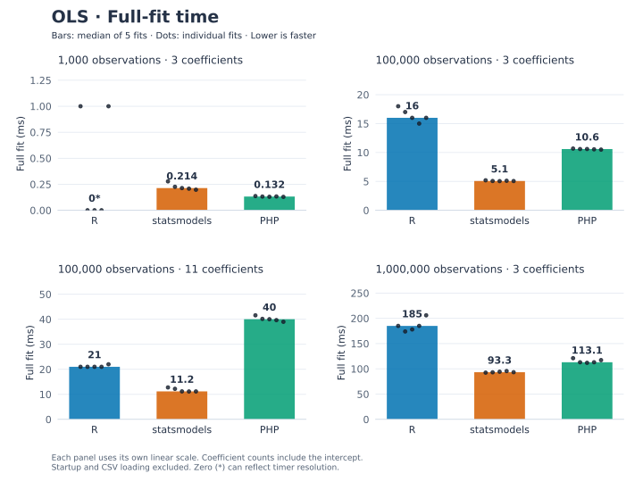
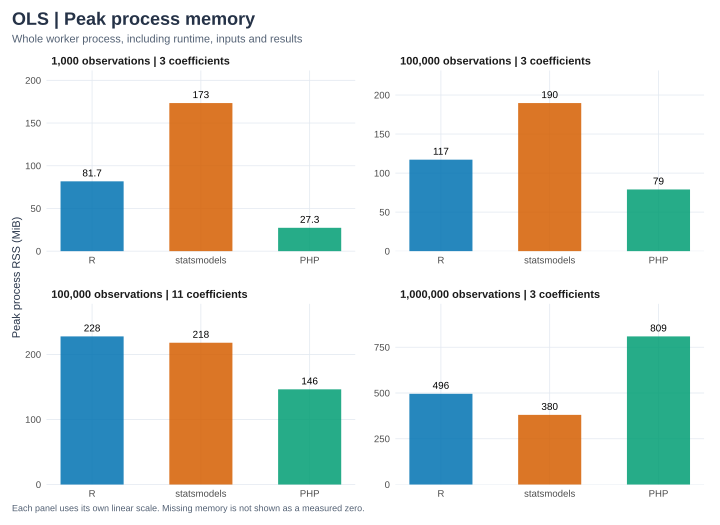

We compare the public PHP extension, R `lm()`, and Python statsmodels `OLS`
on identical simulated observations. The extension uses a **release build**.
The [results JSON](ols-results.json) records every timing sample, versions,
input hashes, numerical outputs, agreement errors and machine information.

## Recorded results

```{python}
from pathlib import Path
import json
import pandas as pd

# Keep display order independent of the benchmark worker execution order.
def ordered_table(rows):
    table = pd.DataFrame(rows)
    table["implementation"] = pd.Categorical(
        table["implementation"], categories=["R", "statsmodels", "PHP"], ordered=True)
    return table.sort_values(["observations", "coefficients", "implementation"]).reset_index(drop=True)

ROOT = next(p for p in [Path.cwd(), *Path.cwd().parents] if (p / "Cargo.toml").exists())
report = json.loads((ROOT / "docs/benchmarks/ols-results.json").read_text())
print("Recorded:", report["recorded_at"])
print("Machine:", report["cpu"], "—", report["platform"])
print("Rust:", report["rust"])
print("Measured repetitions:", report["repeats"], "after", report["warmups"], "warm-up fit")
timings, memory = [], []
for case in report["cases"]:
    assert case["agreement_passed"]
    for name, result in case["implementations"].items():
        timings.append({"observations": case["n"], "coefficients": case["p"],
                        "implementation": name, "version": result["version"],
                        "median fit (seconds)": result["median_fit_seconds"],
                        "minimum fit (seconds)": result["min_fit_seconds"]})
        memory.append({"observations": case["n"], "coefficients": case["p"],
                       "implementation": name, "CSV load (seconds)": result["load_seconds"],
                       "whole process (seconds)": result["process_seconds"],
                       "peak process RSS (MiB)": (result["peak_rss_bytes"] / 2**20
                                                  if result["peak_rss_bytes"] else None)})
display(ordered_table(timings))
```

Coefficient counts include the intercept. Cases cover 1,000, 100,000 and one
million observations with two predictors, plus 100,000 observations with ten
predictors. A tall model with few predictors and a wider model are different
workloads. R's elapsed timer has millisecond resolution on the recorded Mac;
small fits can have coarse or zero readings. Use the larger cases to assess scale.

## Visual comparison

```{python}
#| echo: false
import sys
sys.path.insert(0, str(ROOT / "docs/benchmarks"))
from plots import render_charts
render_charts(report, "ols")
```





R, statsmodels and PHP use the same order and colors throughout. Each panel has
its own linear scale so small workloads remain readable; compare labeled values
across panels. Memory covers the entire worker process. It is not the solver's
allocation count. All workloads passed the numerical checks described below.

Download the timing [SVG](figures/ols-fit-time.svg) or [PNG](figures/ols-fit-time.png),
and memory [SVG](figures/ols-memory.svg) or [PNG](figures/ols-memory.png).
Charts refresh from saved measurements when this page is executed; they do not
rerun the benchmarks.

## Timing boundaries

Each worker loads its inputs once, runs one untimed warm-up, and fits five times.
The table reports median and minimum in-process elapsed wall-clock times.
Inputs are already PHP arrays, an R data frame or NumPy arrays. Generation,
CSV parsing, process startup and final JSON serialization are excluded.
Each timed fit materializes coefficients, covariance, standard errors, Student t
tests, p-values, 95% confidence intervals, all fitted values and residuals, RSS,
variance, R-squared and Gaussian log-likelihood.

PHP timing includes validation, copying PHP inputs into Rust, SVD estimation,
and converting the complete public output into PHP arrays with row metadata.
R uses `lm()` with model/formula construction and inference. Python uses
`OLS(...).fit(use_t=True)` and forces lazy inference and full observation-length
outputs within the timer. Between-fit cleanup occurs outside the fit timer.
These are **API-level comparisons**, not isolated matrix-kernel or language-speed
measurements. R uses QR; statsmodels defaults to pseudoinverse/SVD;
the extension uses column-scaled SVD.

```{python}
display(ordered_table(memory))
```

Whole-process time includes startup/imports, loading, warm-up, all measured fits,
cleanup and compact report serialization. It is not a single cold-fit time.
Peak resident memory covers that entire worker process, including runtime,
inputs, temporary arrays and results; it is not the Rust solver's allocation
count. PHP's memory limit is disabled for these runs because a million nested
arrays can exceed a web application's configured limit.

Workers run separately on the same machine, with order alternated between cases.
Common numerical-library thread environment variables are set to 1. The extension
has no BLAS backend; installed R/NumPy backends and requested settings are recorded.
This controls common threading differences without proving every backend honors
the settings. System activity, caches and thermal state can affect observations.
Five consecutive warm fits do not establish a universal performance ranking.

## Simulation and numerical agreement

NumPy's default RNG uses seed `20261011` for each case. Area is uniform between
35 and 110 square metres; bedrooms depend on area plus noise, rounded and bounded
to 1–4. Wider models add independent standard-normal amenity scores. Fictional
monthly rent follows

$$y_i=650+18\,\mathrm{area}_i+60\,\mathrm{bedrooms}_i
+0.5\sum_j\mathrm{amenity}_{ij}+\epsilon_i,
\qquad\epsilon_i\sim N(0,180^2).$$

These are synthetic observations. This generating model includes a bedroom
effect; the small teaching notebook deliberately has an area-only generating
equation. Large samples contain fresh observations rather than copies of the
eight teaching rows. All runtimes read the same 17-significant-digit CSV;
its hash, population coefficients and sample correlations are recorded.
Input files are temporary and generation is outside worker timings.

The harness checks all coefficients, covariance entries, standard errors,
t-statistics, p-values, confidence bounds and scalar statistics against R using
`1e-9 + 1e-7 * abs(reference)`. Residual df is checked exactly.
Full fitted/residual vectors are calculated, but cross-runtime verification
samples ten evenly spaced observations rather than exporting every value.
Small reference tests compare full vectors. Extremely small p-values can
underflow; the absolute tolerance does not establish relative tail accuracy.

```{python}
agreement = []
for case in report["cases"]:
    for name, errors in case["max_absolute_errors_vs_R"].items():
        agreement.append({"observations": case["n"], "coefficients": case["p"],
                          "implementation": name, "agreement passed": case["agreement_passed"],
                          "largest absolute difference vs R": max(errors.values())})
display(ordered_table(agreement))
```

The initial large-sample run exposed inaccurate 95% Student-t quantiles from
statrs' inverse-beta calculation. The core now finds the critical value by
bisecting the Student-t survival function at probability 0.025. A focused Rust
test checks R `qt()` references through 999,997 residual df with absolute error
below 1e-8. The large-data comparisons keep the original numerical tolerances.

## Reproduce and maintain

Use the [development setup](../development.qmd) and pinned
[notebook dependencies](../notebooks/index.qmd). From the repository root on macOS:

```sh
export PHP=/opt/homebrew/bin/php
export PHP_CONFIG=/opt/homebrew/bin/php-config
cargo build -p php-stats --release --locked
.context/notebooks-venv/bin/python tests/benchmarks/run.py
QUARTO_PYTHON="$PWD/.context/notebooks-venv/bin/python" quarto render docs/benchmarks/ols.qmd
quarto render docs
```

On Linux, choose matching PHP and php-config; the driver defaults to the release
`.so`. Override `STATS_EXTENSION` or `RSCRIPT` when needed. A quick harness check
that preserves the published report is:

```sh
.context/notebooks-venv/bin/python tests/benchmarks/run.py \
  --cases 1000:3 --repeats 2 --output .context/benchmark-smoke.json
```

`--cases` accepts comma-separated `n:p` pairs with the intercept included in $p$
and $n>p\ge3$. `--repeats` changes the measured fit count. The driver writes a
report only after all cases pass; worker errors and numerical discrepancies fail
the run. Peak RSS uses `/usr/bin/time` on macOS/Linux when available. Workers have
a ten-minute timeout. Benchmarks run explicitly, separate from `cargo test` and
normal documentation rendering. Saved outputs allow rendering without running them.

Future estimators should maintain equivalent R/statsmodels comparisons where
supported: shared simulated inputs, complete requested outputs, numerical checks,
release builds, raw timings, versions, machine details and stated boundaries.
Run this suite when changing numerical implementation. Keep observed results with
verification evidence; optimize only when measurements establish a need.

## Apple Accelerate experiment

**Historical experiment:** the optional macOS `accelerate` feature was removed
after choosing to keep the numerical engine Rust-native until a concrete need
justifies an external backend. This section preserves the observed results, not
a currently available build option.

The trial replaced the column-scaled SVD with
Apple Accelerate's LAPACK `DGESDD` in thin mode. PHP conversion, validation,
rank threshold, coefficient solving, covariance and inference remain shared.
This experiment accelerates the decomposition; it does not route every nalgebra
matrix multiplication through BLAS. The default build stays portable Rust.

Both variants passed the Rust R-reference and invalid-input tests. The Accelerate
extension also passed PHP integration tests. The following independently timed
runs use identical generated CSVs, verified by their hashes; both check numerical
agreement with R and statsmodels using the same tolerances and sampled outputs.
The [Accelerate raw results](ols-accelerate-results.json) accompany the
[archived baseline](ols-accelerate-baseline.json), with separate extension hashes and every timing sample.

```{python}
accelerate = json.loads((ROOT / "docs/benchmarks/ols-accelerate-results.json").read_text())
assert accelerate["backend_label"] == "Apple Accelerate"
experiment_baseline = json.loads((ROOT / "docs/benchmarks/ols-accelerate-baseline.json").read_text())
assert accelerate["cpu"] == experiment_baseline["cpu"]
assert accelerate["thread_environment"] == experiment_baseline["thread_environment"]
baseline_cases = {(case["n"], case["p"]): case for case in experiment_baseline["cases"]}
comparison = []
for case in accelerate["cases"]:
    baseline = baseline_cases[case["n"], case["p"]]
    assert case["data"]["sha256"] == baseline["data"]["sha256"]
    assert case["agreement_passed"] and baseline["agreement_passed"]
    pure = baseline["implementations"]["PHP"]
    native = case["implementations"]["PHP"]
    comparison.append({"observations": case["n"], "coefficients": case["p"],
                       "PHP nalgebra (ms)": 1000 * pure["median_fit_seconds"],
                       "PHP Accelerate (ms)": 1000 * native["median_fit_seconds"],
                       "speedup (nalgebra / Accelerate)": pure["median_fit_seconds"] / native["median_fit_seconds"],
                       "R in Accelerate run (ms)": 1000 * case["implementations"]["R"]["median_fit_seconds"],
                       "statsmodels in Accelerate run (ms)": 1000 * case["implementations"]["statsmodels"]["median_fit_seconds"],
                       "PHP nalgebra peak RSS (MiB)": pure["peak_rss_bytes"] / 2**20,
                       "PHP Accelerate peak RSS (MiB)": native["peak_rss_bytes"] / 2**20})
print("Baseline recorded:", experiment_baseline["recorded_at"])
print("Accelerate recorded:", accelerate["recorded_at"])
display(pd.DataFrame(comparison).sort_values(["observations", "coefficients"]).reset_index(drop=True))
```

A ratio above 1 means the Accelerate variant was faster in this run. These are
two sequential five-repeat experiments, not randomized paired trials. Variation
in the R/Python control measurements helps show why small differences should not
be treated as conclusive. Matrix shape matters, and PHP input/output allocation
still contributes to complete-fit time and memory.

**Observed outcome:** this experiment did not establish a speed advantage for
Accelerate on these shapes. The 100,000-row, three-coefficient case was roughly
tied; the million-row case took about 133 ms with Accelerate versus 113 ms with
nalgebra, and the eleven-coefficient case took about 42 ms versus 40 ms.
The nalgebra implementation is now the sole maintained path. The experimental
feature and LAPACK dependencies were removed; recorded results remain available. These timings alone do
not isolate decomposition time from PHP conversion or native allocations, so
they do not establish the cause of the differences.

Symbol inspection reveals a backend-interface difference: the Rust `lapack`
bindings call `_dgesdd_`, while this NumPy installation calls
`_dgesdd$NEWLAPACK$ILP64`. Both link Apple's Accelerate framework, but these
are different LAPACK interfaces. This trial therefore does not establish how
Rust would perform through NumPy's newer interface, nor whether that difference
caused the observed timings. The report records the imported symbols; only the
legacy LAPACK binding was used for this trial.

The historical reports retain individual timings, input hashes, imported symbols
and artifact hashes. Their implementation is no longer maintained in this checkout;
there is no current `accelerate` build feature. Keeping a separate archived baseline
preserves this comparison when the standard Rust/R/statsmodels report is refreshed.
Linux/OpenBLAS was not implemented or verified by this experiment.
